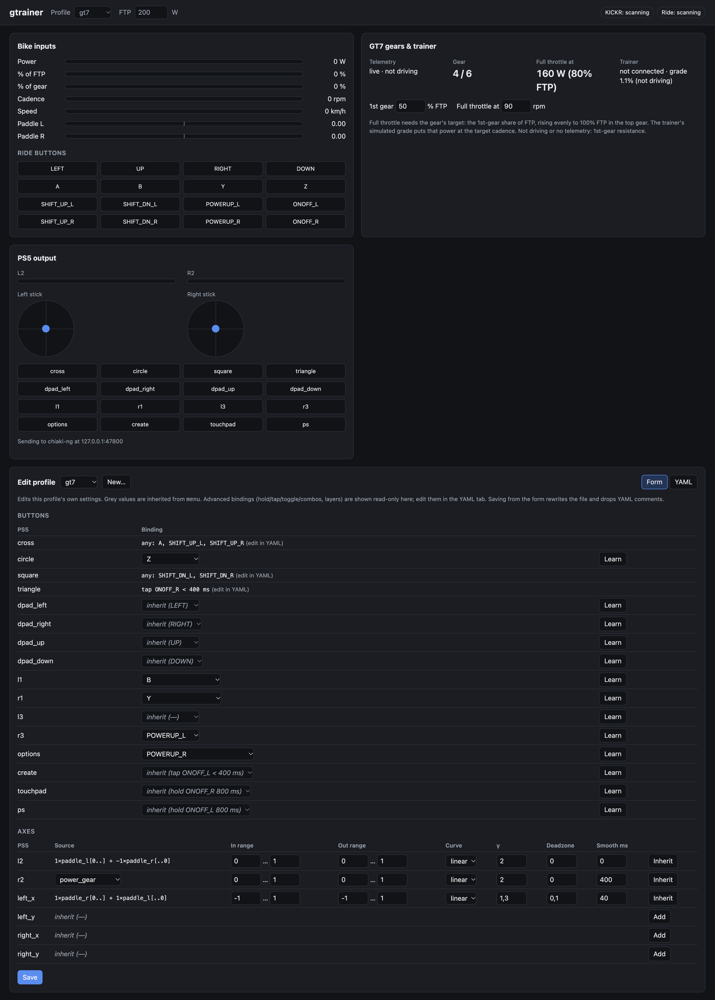

# gtrainer

Use your **smart bike trainer as a PS5 controller**. Pedal power is the throttle in
Gran Turismo 7, the Zwift Ride handlebar steers, brakes and shifts, and GT7's gears
set your trainer's resistance.

> **Status: proof of concept.** Tested with one setup: Wahoo KICKR CORE (fw 3.5.34),
> Zwift Ride (hw B.0, fw 1.2.0), PS5, Apple Silicon Mac. Expect rough edges.

```
KICKR (FTMS) ───BLE──┐                                        ┌─ GT7 telemetry (UDP, gear, on-track)
                     ├─► gtrainer bridge (Python, your Mac) ◄─┘
Zwift Ride ─────BLE──┘     mapping profiles + web UI
                              │  UDP 127.0.0.1:47800              ┌─► trainer resistance (FTMS simulation)
                              ▼                                   │
                     chiaki-ng (patched) ──Remote Play──► PS5 ──► TV
```

## Why Remote Play?

PS5-native games only accept authenticated controllers, so a home-made USB or
Bluetooth gamepad doesn't work. Instead, gtrainer feeds its input into
[chiaki-ng](https://github.com/streetpea/chiaki-ng), an open-source PlayStation Remote
Play client, through a small patch that adds a local UDP input source. The PS5 keeps
showing the game on your TV; the chiaki-ng window can stay minimized, and only the
controller input travels over your LAN.

## Features

- **Throttle from pedal power**, relative to your FTP or, with GT7 telemetry, to the current gear's target power.
- **GT7 gears → trainer resistance** (experimental): every gear changes the simulated gradient.
- **Zwift Ride handlebar:** all 16 buttons plus both analog paddles. The paddles swing both ways and work as steering and analog brake.
- **Configurable mapping profiles** (YAML) with curves, deadzones, smoothing, combos,
  tap/hold/toggle buttons, threshold buttons and layers. Profiles can inherit from
  each other, and they reload live as you edit them.
- **Local web UI** with live meters, a preview of what the PS5 receives, and profile and settings editing.
- **Simulation mode** to try everything without hardware.
- **Safety:** if the bridge stops, chiaki-ng releases all inputs within 250 ms; on exit
  the trainer is handed back to its default mode.

## Web UI

The bridge serves a local control panel at http://127.0.0.1:8765. It shows:
- live bike inputs and Ride buttons
- the current GT7 gear, its target power and the trainer's gradient
- a preview of the controller state sent to the PS5
- a profile editor (form or YAML) with "Learn" buttons for picking Ride buttons

<p align="center"></p>

## Requirements

| | Tested | Should work |
|---|---|---|
| Computer | Apple Silicon Mac (macOS) | Other Macs. Linux needs a chiaki-ng build of your own (untested). |
| Trainer | Wahoo KICKR CORE | Any trainer with Bluetooth FTMS (indoor bike data; simulation mode for resistance control) |
| Controller | Zwift Ride, firmware **1.2.0** | Zwift Ride ≤ 1.2.x. Firmware 1.3+ ("Ride V2") is locked to Zwift and won't work. |
| Console | PS5 with Remote Play enabled | PS4 (untested) |
| Game | Gran Turismo 7 | Any game for the controls; the telemetry features are GT7-only |

Software: [Homebrew](https://brew.sh), [uv](https://docs.astral.sh/uv/), Xcode Command Line Tools, git.

## Setup guide

### 1. Get the code

```sh
git clone https://github.com/<you>/gtrainer.git
cd gtrainer
```

### 2. Build the patched chiaki-ng (one-time, ~20–40 minutes)

```sh
chiaki/build.sh --deps     # installs Homebrew deps (Qt 6, ffmpeg, …), clones chiaki-ng, patches, builds
```

The script pins a known chiaki-ng commit, applies `chiaki/external-input.patch`, works
around a Homebrew OpenSSL 3/4 header clash, and code-signs the app locally so that
macOS lets it use the local network. Result: `chiaki/src/build/gui/chiaki.app`.

### 3. Pair chiaki-ng with your PS5 (one-time)

1. On the PS5: Settings → System → Remote Play → turn on **Enable Remote Play**.
   For waking the console from rest mode, also enable Power Saving → Features Available in Rest Mode → Stay Connected to the Internet.
2. Start chiaki-ng: `open chiaki/src/build/gui/chiaki.app`. If macOS asks to let it find
   devices on your local network, click **Allow**.
3. Your PS5 should appear in the list. Click it to register:
   - Log in to PSN when asked (that gives chiaki-ng your account ID).
   - On the PS5, open Settings → System → Remote Play → **Pair Device** and enter the PIN shown.
4. Connect once to check that the stream works.

### 4. Install the bridge

```sh
cd bridge
uv sync
uv run gtrainer --sim --open      # no hardware needed: synthetic trainer, clickable Ride buttons
```

### 5. Check your hardware (recommended, read-only)

Close Zwift and any other app that might be connected to the trainer or the Ride first.

```sh
uv run python tools/probe.py scan     # list Bluetooth devices
uv run python tools/probe.py ride     # press every button and both paddles
uv run python tools/probe.py kickr    # pedal for ~20 s
uv run python tools/gt7_probe.py      # GT7 telemetry (GT7 must be running)
```

macOS will ask for Bluetooth permission for your terminal on first use.

To test the chiaki-ng path without any bike hardware, connect chiaki-ng to the PS5 and
run `uv run python tools/send_test_state.py`: the D-pad should move on the PS5's home screen.

### 6. Ride

1. Wake the trainer and the Ride.
2. Start chiaki-ng and connect to the PS5 (you can minimize the window).
3. Start the bridge:
   ```sh
   cd bridge
   caffeinate -i uv run gtrainer --profile gt7 --gt7 --ftp 250 --open
   ```
4. In the web UI (http://127.0.0.1:8765) check that both devices are connected, and set your FTP.

Useful flags: `--profile walking|menu|<yours>`, `--gt7` (telemetry: gear-based
throttle plus trainer resistance), `--ps5 <ip>` (skip PS5 discovery), `--no-resistance`
(telemetry without touching the trainer), `--kickr-name`, `--ride-name`, `-v`.

## GT7 mode: gears and resistance

With `--gt7`, the bridge reads GT7's telemetry (the current gear, the car's number of gears, on-track and paused state):

- Each gear has a **target power**: the 1st-gear share of your FTP (default 50%),
  rising evenly to **100% FTP in the top gear**. For example, with FTP 200 W and a 6-speed: 100 → 120 → 140 → 160 → 180 → 200 W.
- **Throttle = your power ÷ the current gear's target**, so reaching the target means full throttle.
- **Resistance:** the trainer runs in simulation mode with no air drag, so power rises
  in a straight line with cadence. Each gear sets the gradient at which its target
  power comes at your **target cadence** (default 90 rpm). The gear decides how heavy
  it feels, and spinning at 90 rpm gives full throttle in any gear. The gradient is
  calibrated with the rider weight stored on the trainer and the trainer's own speed-per-rpm ratio, which the bridge learns as you ride.
- **Not driving** (menus, paused, loading, replays) **or no telemetry:** 1st-gear resistance, so you can soft-pedal.
- Without telemetry, the throttle falls back to power ÷ FTP.

The 1st-gear share and the target cadence are set in the web UI's "GT7 gears & trainer" panel.

### Default GT7 controls (`gt7` profile)

| Zwift Ride | GT7 |
|---|---|
| Pedal power | Throttle (R2) |
| Paddles, outer swing | Steer left / right |
| Paddles, inner swing (either) | Brake (L2, analog); also cuts the throttle |
| Upper shifters (either side) | Shift up (✕) |
| Lower shifters (either side) | Shift down (□) |
| A / Z | ✕ (confirm) / ○ (back) |
| B / Y | Look back (L1) / change view (R1) |
| Left powerup | Nitrous / overtake (R3) |
| Right powerup | Options |
| Tap / hold right on-off | △ / touchpad |
| Tap / hold left on-off | Create / PS |
| D-pad | D-pad |

The button roles follow GT7's default controller layout. If you've remapped them in GT7, adjust the profile.

## Profiles

Profiles live in `bridge/profiles/*.yaml`. They reload as soon as you save, from the
web UI or any editor, and an invalid profile is rejected while the last valid one stays active.

```yaml
name: GT7
extends: menu                  # inherit; entries here replace the parent's, null removes one
axes:                          # l2 r2 left_x left_y right_x right_y
  r2:
    source: power_gear
    in: [0, 1]
    smooth_ms: 400             # smoothing while rising...
    release_ms: 0              # ...and while falling back toward zero (default: same as smooth_ms)
    zero_when:                 # force 0 while any condition holds (e.g. braking cuts the throttle)
      - {source: paddle_l, above: 0.15}
      - {source: paddle_r, below: -0.15}
  left_x:
    combine:
      - {source: paddle_r, min: 0}             # min/max clip a term: only the positive swing
      - {source: paddle_l, max: 0}
    in: [-1, 1]
    out: [-1, 1]               # sticks: -1..1 (y: negative = forward); triggers: 0..1
    deadzone: 0.06
    curve: expo
  l2:
    mix: max                   # combine as the strongest input (default: sum)
    combine: [{source: paddle_l, min: 0}, {source: paddle_r, max: 0, scale: -1}]
buttons:                       # cross circle square triangle dpad_* l1 r1 l3 r3 options create touchpad ps
  cross: [A, SHIFT_UP_L, SHIFT_UP_R]           # any of
  ps: {combo: [ONOFF_L, ONOFF_R]}              # all held
  options: {tap: ONOFF_R, ms: 400}             # short press
  touchpad: {hold: ONOFF_R, ms: 800}           # long press
  l3: {toggle: Y}
  r3: {signal: cadence_rpm, above: 100}        # threshold on an analog signal
layers:                        # override bindings while active
  nav: {toggle: POWERUP_L, buttons: {dpad_up: UP}, axes: {right_y: null}}
```

- **Sources:**
  - `power_w`
  - `power_ftp` (power ÷ FTP)
  - `power_gear` (power ÷ the current GT7 gear's target)
  - `cadence_rpm`, `speed_kph`
  - `paddle_l`, `paddle_r` (−1..1)
  - `btn:<RideButton>` (0/1)
- **Ride buttons:** `LEFT UP RIGHT DOWN A B Y Z SHIFT_UP_L SHIFT_DN_L SHIFT_UP_R SHIFT_DN_R POWERUP_L POWERUP_R ONOFF_L ONOFF_R`.
- **Rider settings** (FTP, 1st-gear share, target cadence) are stored in `bridge/rider.yaml` and editable in the web UI.

## Troubleshooting

| Problem | Fix |
|---|---|
| chiaki-ng: "Regist search failed" | macOS is blocking local network access. Rebuild with `chiaki/build.sh` (it signs the app), launch it with `open`, and allow it in System Settings → Privacy & Security → Local Network. |
| Trainer or Ride "not found" | Close Zwift and any other app connected to them (Bluetooth devices usually allow only one or a few connections), and wake the device. |
| Ride connects but no buttons | Check the firmware with `tools/probe.py ride`; 1.3+ is locked to Zwift. If every button reads as pressed, start the bridge with `--ride-set-bit-pressed`. |
| Throttle feels laggy | The KICKR reports power about once per second. `smooth_ms` smooths the rise, `release_ms: 0` lets it drop immediately, and `zero_when` gives an instant cut (in the `gt7` profile, braking cuts the throttle). The trainer's own once-per-second reporting can't be made faster. |
| Resistance doesn't change | Run with `--gt7` and check the web UI's trainer status. "denied" means another app controls the trainer: close it, and the bridge requests control again within about 5 s. |
| GT7: stuck on "searching for PS5" or "can't reach the local network" | macOS blocks LAN access per app. Allow the app you start gtrainer from (Terminal, iTerm, IntelliJ, VS Code, …) in System Settings → Privacy & Security → **Local Network**, then restart that app. |
| No GT7 telemetry | GT7 must be running. Pass `--ps5 <ip>` if discovery fails. "can't listen on UDP 33740" means another gtrainer or `gt7_probe.py` is still running. |
| Web UI answers "forbidden: non-local origin" | The UI only accepts requests addressed to `127.0.0.1` or `localhost` (this blocks other web pages from controlling the bridge). Open it at http://127.0.0.1:8765. |
| Web UI doesn't update | Run `uv sync` (the live feed needs the `websockets` package) and restart the bridge. |

## Safety and limitations

- The bridge **controls your trainer's resistance** when started with `--gt7`. Keep a
  hand on the brakes, and know that easing off the pedals is always safe.
- Power data arrives at about 1 Hz on the KICKR, so the throttle lags your legs by up to a second.
- The Zwift Ride protocol is community reverse-engineered and may break with firmware updates. Don't update your Ride.
- Remote Play adds some input latency (typically small on a wired LAN).

## Development

```sh
cd bridge && uv run pytest
```

- The decoders are tested against real captures from a Zwift Ride and a KICKR CORE.
- The chiaki-ng change lives in `chiaki/external-input.patch` (about 200 lines), pinned in `chiaki/build.sh`.
- Packet format (23 bytes, little-endian): `"CTRN" | u8 version | u32 seq | u32 buttons | u8 l2 | u8 r2 | i16 lx ly rx ry`.

## License

See [LICENSE](LICENSE). The chiaki-ng patch in `chiaki/` modifies chiaki-ng and is therefore licensed under the AGPL-3.0, like chiaki-ng itself.

## Credits

gtrainer stands on the shoulders of these projects and people:

- **[chiaki-ng](https://github.com/streetpea/chiaki-ng)** by streetpea and contributors, the
  open-source PlayStation Remote Play client that gtrainer patches and builds, itself a
  fork of **[Chiaki](https://git.sr.ht/~thestr4ng3r/chiaki)** by Florian Märkl. Its
  Remote Play discovery message is also used to find the PS5 on the network. (AGPL-3.0)
- **[BikeControl](https://github.com/OpenBikeControl/bikecontrol)** (formerly SwiftControl)
  by Jonas Bark. Reference for the Zwift Ride protocol: Bluetooth service and characteristic UUIDs, the "RideOn"
  handshake, button masks, the paddle message layout, and the firmware 1.3 ("Ride V2")
  lock. Used as documentation only; no code was copied.
- **[RideToWoosh](https://github.com/TheInGoF/RideToWoosh)** by TheInGoF. Zwift Ride to
  keyboard on an ESP32: the handshake flow and the inverted button-bit polarity.
- **MAKINOLO**, for the public reverse engineering of the Zwift Ride button message (protobuf message `0x23`), credited by RideToWoosh.
- **[zwiftplay](https://github.com/ajchellew/zwiftplay)** by ajchellew. Zwift Play
  protocol notes (characteristics, handshake, protobuf payloads), the foundation for the Ride work.
- **[gt7telemetry](https://github.com/Bornhall/gt7telemetry)** by Bornhall. GT7
  telemetry heartbeat, Salsa20 decryption, and field offsets (gear, rpm, speed, gear ratios).
- **[gt7-udp](https://github.com/MacManley/gt7-udp)** by MacManley. GT7 packet structure: the simulator flags, the gear byte, and the gear-ratio array.
- **[PDTools](https://github.com/Nenkai/PDTools)** by Nenkai. The original reverse engineering of GT7's Simulator Interface packet that the projects above build on.
- **Bluetooth SIG** Fitness Machine Service (FTMS) and Cycling Power Service specifications: trainer data and simulation-mode control.
- Libraries: [Bleak](https://github.com/hbldh/bleak), [FastAPI](https://fastapi.tiangolo.com),
  [Uvicorn](https://github.com/encode/uvicorn), [websockets](https://github.com/python-websockets/websockets),
  [Pydantic](https://docs.pydantic.dev), [PyYAML](https://pyyaml.org),
  [watchfiles](https://github.com/samuelcolvin/watchfiles),
  [PyCryptodome](https://www.pycryptodome.org), [uv](https://docs.astral.sh/uv/).

## Disclaimer

gtrainer is an independent hobby project. It is not affiliated with, endorsed by, or
sponsored by Sony Interactive Entertainment, Polyphony Digital, Zwift, or Wahoo
Fitness. PlayStation, PS5, DualSense, Gran Turismo, Zwift, Zwift Ride and KICKR are trademarks of their respective owners.
